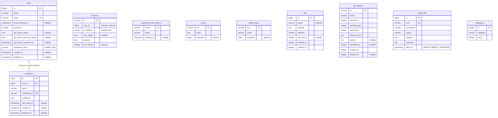
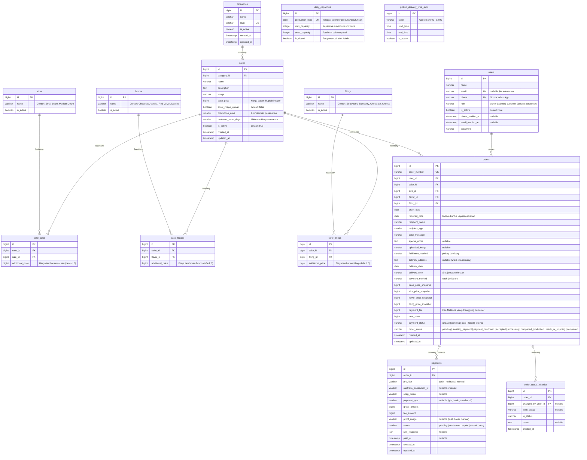

# Skema Database (Database Schema) — TBloom Cake

Dokumen ini memisahkan secara tegas antara:

1. **Bagian A — Skema Aktual yang Sudah Diimplementasikan di Repository (`[FACT - Implemented]`)**: 10 tabel PostgreSQL 18 yang berasal dari 5 file migrasi di `database/migrations/`.
2. **Bagian B — Rancangan Skema Domain TBloom Cake (`[PROPOSED / CONFIRMED - Planned]`)**: Rancangan tabel untuk fitur RBAC, OTP WhatsApp, Katalog Kue, Kapasitas Produksi Harian, Pesanan, dan Pembayaran yang telah didefinisikan dalam spesifikasi bisnis tetapi **belum dibuat migrasinya di repository**.

> **Aturan untuk AI Agent:** Jangan mengasumsikan tabel pada **Bagian B** sudah ada di database sebelum Anda memeriksa `database/migrations/` atau menjalankan tool `database-schema`.

---

## BAGIAN A: Skema Database Aktual di Repository (`[FACT - Implemented]`)

### A.1 Konfigurasi Mesin Database

- **Engine:** **PostgreSQL 18** (`DB_CONNECTION=pgsql` di `config/database.php`).
- **Database Aplikasi:** `tbloom` (`127.0.0.1:5432`).
- **Database Pengujian (`phpunit.xml`):** `tbloom_test`.
- **Jumlah Tabel Aktual Saat Ini:** **10 tabel** pada skema `public`.

### A.2 ERD Skema Aktual (`FACT`)

### A.3 Rincian 10 Tabel Aktual (`FACT`)

1. **`users`** (`0001_01_01_000000_create_users_table.php` & `2025_08_14_170933_add_two_factor_columns_to_users_table.php`):
    - `id` (PK bigint), `name` (varchar 255), `email` (varchar 255, unique), `email_verified_at` (timestamp nullable), `password` (varchar 255), `two_factor_secret` (text nullable), `two_factor_recovery_codes` (text nullable), `two_factor_confirmed_at` (timestamp nullable), `remember_token` (varchar 100 nullable), `created_at`, `updated_at`.
2. **`passkeys`** (`2024_01_01_000000_create_passkeys_table.php`):
    - `id` (PK bigint), `user_id` (FK `users.id` `cascadeOnDelete`, indexed), `name` (varchar 255), `credential_id` (varchar 255, unique), `credential` (json), `last_used_at` (timestamp nullable), `created_at`, `updated_at`.
3. **`password_reset_tokens`** (`0001_01_01_000000_create_users_table.php`):
    - `email` (PK varchar 255), `token` (varchar 255), `created_at` (timestamp nullable).
4. **`sessions`** (`0001_01_01_000000_create_users_table.php`):
    - `id` (PK varchar 255), `user_id` (bigint nullable, indexed), `ip_address` (varchar 45 nullable), `user_agent` (text nullable), `payload` (text), `last_activity` (integer, indexed).
5. **`cache` & `cache_locks`** (`0001_01_01_000001_create_cache_table.php`):
    - `cache`: `key` (PK), `value` (text), `expiration` (bigint, indexed).
    - `cache_locks`: `key` (PK), `owner` (varchar), `expiration` (bigint, indexed).
6. **`jobs`, `job_batches`, & `failed_jobs`** (`0001_01_01_000002_create_jobs_table.php`):
    - Tabel standar antrean database Laravel.
7. **`migrations`**: Tabel pencatat riwayat migrasi Laravel.

---

## BAGIAN B: Rancangan Skema Domain TBloom Cake (`[PROPOSED / CONFIRMED - Planned]`)

Bagian ini mendokumentasikan struktur tabel yang dibutuhkan untuk mengimplementasikan spesifikasi bisnis **TBloom Cake** (belum ada di `database/migrations/`).

### B.1 ERD Rancangan Domain TBloom Cake (`Planned`)

### B.2 Penjelasan Tabel Rancangan (`Planned`)

1. **Perluasan Tabel `users` (`[CONFIRMED - Planned]`):**
    - Penambahan kolom `role` (`varchar`, nilai: `'owner' | 'admin' | 'customer'`, default `'customer'`, indexed).
    - Penambahan kolom `phone` (`varchar(30)`, unique, nomor WhatsApp pelanggan).
    - Penambahan kolom `phone_verified_at` (`timestamp`, nullable) untuk mencatat waktu verifikasi OTP Fonnte.
    - Penambahan kolom `is_active` (`boolean`, default `true`) agar Owner dapat mengatur status aktif/nonaktif akun Admin.
2. **Tabel `whatsapp_otps` (`[PROPOSED - Planned]`):**
    - Menyimpan kode OTP verifikasi WhatsApp yang dikirim melalui Fonnte API (`id`, `phone`, `code_hash`, `expires_at`, `attempts`, `verified_at`, `created_at`).
3. **Tabel Katalog & Opsi (`categories`, `cakes`, `sizes`, `flavors`, `fillings`, `cake_sizes`, `cake_flavors`, `cake_fillings`) (`[CONFIRMED / PROPOSED - Planned]`):**
    - `cakes` menyimpan `base_price`, `allow_image_upload` (`boolean`), `production_days` (`integer`), `minimum_order_days` (`integer`), dan `is_active` (`boolean`).
    - Pivot `cake_sizes`, `cake_flavors`, dan `cake_fillings` memiliki `additional_price` (integer Rupiah, default `0`) serta unique composite index `(cake_id, size_id)`, `(cake_id, flavor_id)`, dan `(cake_id, filling_id)`.
4. **Tabel Kapasitas Produksi Harian (`daily_capacities`) & Slot Jam (`pickup_delivery_time_slots`) (`[PROPOSED - Planned]`):**
    - `daily_capacities` menyimpan `production_date` (`date`, unique), `max_capacity` (`integer`), `used_capacity` (`integer`), dan `is_closed` (`boolean`).
    - Saat proses checkout berlangsung, baris `daily_capacities` untuk `required_date` dikunci menggunakan `SELECT ... FOR UPDATE` (`lockForUpdate()`) di dalam `DB::transaction()` untuk memvalidasi `max_capacity - used_capacity >= 1` secara atomik.
5. **Tabel `orders`, `payments`, dan `order_status_histories` (`[CONFIRMED / PROPOSED - Planned]`):**
    - Menyimpan _snapshot_ harga pada saat pesanan dibuat (`base_price_snapshot`, `size_price_snapshot`, `flavor_price_snapshot`, `filling_price_snapshot`, `payment_fee`, `total_price`) agar perubahan harga master kue di masa depan tidak mengubah total harga pesanan historis.
    - Menyimpan `fulfillment_method` (`pickup` | `delivery`), `payment_method` (`cash` | `midtrans`), `payment_status`, dan `order_status`.
    - `order_status_histories` mencatat audit trail setiap kali Admin atau webhook sistem mengubah status pesanan.
6. **Tabel Statistik Pengunjung (`visitor_logs` / `daily_visit_stats`) (`[PROPOSED - Planned]`):**
    - Diperlukan untuk mendukung fitur **Dashboard Statistik Bisnis Owner** (statistik jumlah pengunjung website).
