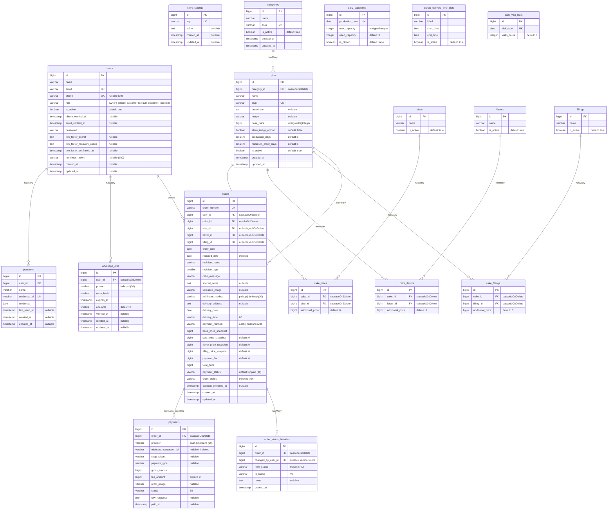

# Skema Database (Database Schema) — TBloom Cake

Dokumen ini mencatat seluruh skema database aktual **TBloom Cake (`tbloom`)** yang telah diimplementasikan melalui **14 file migrasi** di `database/migrations/` (**`[FACT - Implemented]`**).

---

## 1. Konfigurasi Mesin Database (`[FACT - Implemented]`)

- **Engine:** **PostgreSQL 18** (`DB_CONNECTION=pgsql` di `config/database.php`).
- **Database Aplikasi:** `tbloom` (`127.0.0.1:5432`).
- **Database Pengujian (`phpunit.xml`):** `tbloom_test`.
- **Total Migrasi Aktif:** **14 file migrasi** (**26 tabel** termasuk `migrations`).

---

## 2. ERD Skema Aktual TBloom Cake (`[FACT - Implemented]`)

---

## 3. Rincian Migrasi & Tabel Aktual (`[FACT - Implemented]`)

1. **Fondasi & Autentikasi Sistem (5 file migrasi, 10 tabel):**
    - `0001_01_01_000000_create_users_table.php` -> `users`, `password_reset_tokens`, `sessions`.
    - `0001_01_01_000001_create_cache_table.php` -> `cache`, `cache_locks`.
    - `0001_01_01_000002_create_jobs_table.php` -> `jobs`, `job_batches`, `failed_jobs`.
    - `2024_01_01_000000_create_passkeys_table.php` -> `passkeys`.
    - `2025_08_14_170933_add_two_factor_columns_to_users_table.php` -> kolom 2FA pada `users`.
2. **Fase 1 — RBAC, OTP WhatsApp, & Pengaturan Toko (3 file migrasi):**
    - `2026_11_17_000001_add_role_and_phone_to_users_table.php`: menambah `role`, `phone`, `phone_verified_at`, `is_active` ke `users`.
    - `2026_11_17_000002_create_whatsapp_otps_table.php`: tabel `whatsapp_otps`.
    - `2026_11_17_000003_create_store_settings_table.php`: tabel `store_settings` (`default_daily_capacity`, `whatsapp_admin_number`, `midtrans_fee_type`, `midtrans_fee_value`).
3. **Fase 2 — Katalog Kue, Opsi, Kapasitas Harian, Slot Jam, & Pengunjung (5 file migrasi):**
    - `2026_11_18_000001_create_categories_table.php`: tabel `categories`.
    - `2026_11_18_000002_create_cakes_table.php`: tabel `cakes` dengan index `['is_active', 'category_id']`.
    - `2026_11_18_000003_create_cake_options_tables.php`: `sizes`, `flavors`, `fillings`, `cake_sizes`, `cake_flavors`, `cake_fillings` (unique composite per opsi-kue & `additional_price`).
    - `2026_11_18_000004_create_daily_capacities_and_time_slots_tables.php`: `daily_capacities` (row locking via `SELECT ... FOR UPDATE`) & `pickup_delivery_time_slots`.
    - `2026_11_18_000005_create_daily_visit_stats_table.php`: `daily_visit_stats` (pencatatan statistik kunjungan harian Owner).
4. **Fase 3 — Transaksi Pesanan, Pembayaran Midtrans/Cash, & Riwayat Status (1 file migrasi):**
    - `2026_11_21_000001_create_orders_table.php`: tabel `orders` (menyimpan _snapshot_ harga & `capacity_released_at` untuk pengembalian kapasitas idempoten), `payments`, dan `order_status_histories`.
