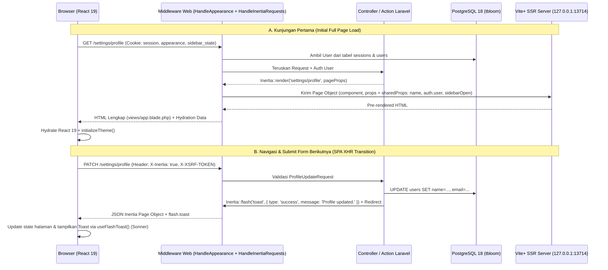
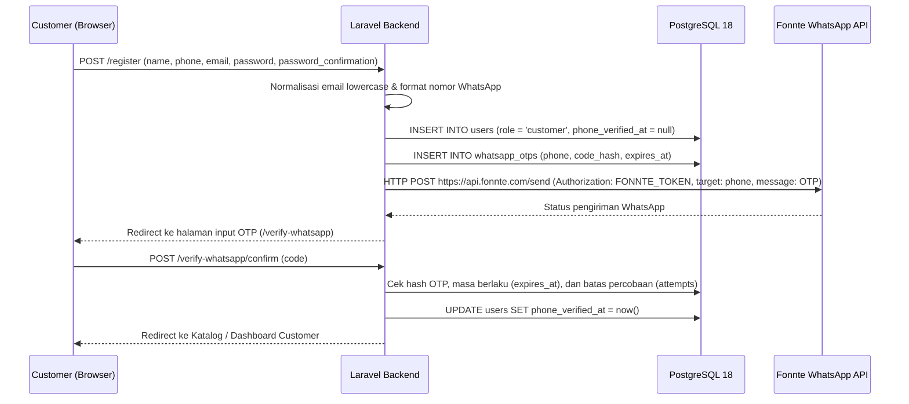
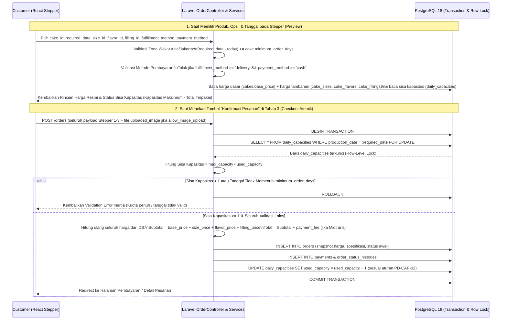
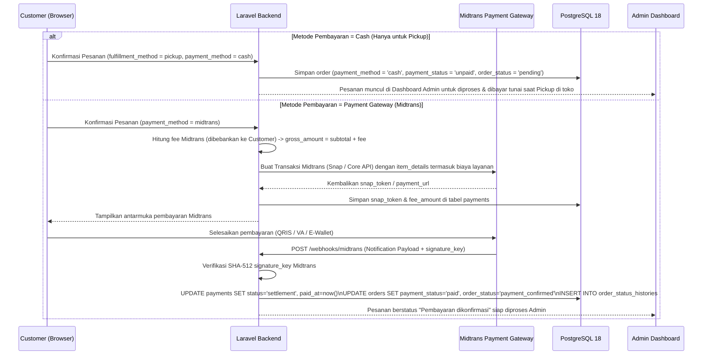

# Aliran Data Sistem (Data Flow) — TBloom Cake

Dokumen ini menjelaskan bagaimana data mengalir di antara Browser (React 19 + Inertia.js v3), Server Aplikasi (Laravel 13), Database (**PostgreSQL 18**), dan Layanan Eksternal (**Fonnte API** serta **Midtrans**).

---

## 1. Aliran Data Request Lifecycle Inertia.js v3 (`[FACT - Implemented]`)

---

## 2. Aliran Data Registrasi Customer & Verifikasi OTP WhatsApp via Fonnte API (`[CONFIRMED - Planned]`)

---

## 3. Aliran Data Validasi Tanggal, Locking Kapasitas Produksi Harian, & Kalkulasi Harga (`[CONFIRMED - Planned]`)

Aliran data ini adalah bagian paling kritis untuk menjamin:

1. Tidak ada manipulasi harga dari sisi klien (_client-side tampering_).
2. Tidak terjadi _overbooking_ (_race condition_) pada kapasitas produksi harian.

---

## 4. Aliran Data Pembayaran Midtrans & Cash (`[CONFIRMED - Planned]`)

---

## 5. Aliran Data Statistik Dashboard Owner (`[CONFIRMED - Planned]`)

1. **Total Penghasilan / Pendapatan:** Dihitung melalui query agregasi `SUM(total_price)` (atau `subtotal` bersih tanpa fee gateway) dari tabel `orders` / `payments` yang telah berstatus lunas (`paid` / `completed`).
2. **Total Akun Customer Terdaftar:** Dihitung melalui `User::where('role', 'customer')->count()`.
3. **Statistik Jumlah Pengunjung Website:** Dicatat oleh middleware pencatat kunjungan ringan ke tabel statistik pengunjung dan diagregasi per rentang waktu pada Dashboard Owner.
