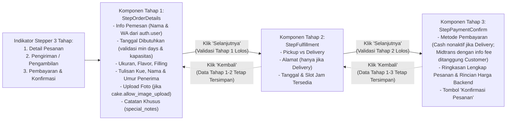

# Arsitektur Frontend (Frontend Architecture) — TBloom Cake

Dokumen ini menjelaskan arsitektur frontend React 19 + Inertia.js v3 yang sudah berjalan di repository (`[FACT - Implemented]`) serta rancangan arsitektur komponen untuk fitur Katalog Kue, Form Pemesanan Stepper 3 Tahap, Dashboard Admin, dan Dashboard Owner (`[CONFIRMED / PROPOSED - Planned]`).

---

## 1. Stack Teknologi Frontend Aktual (`[FACT - Implemented]`)

- **React 19 (`^19.2.0`) + React Compiler (`babel-plugin-react-compiler: ^1.0.0`):** Komponen fungsional modern dengan optimasi memoization otomatis saat build.
- **TypeScript (`^5.7.2`):** Mode ketat (`strict: true`, `noImplicitAny: true`), path alias `@/* -> ./resources/js/*`.
- **Inertia.js v3 (`@inertiajs/react: ^3.0.0`, `@inertiajs/vite: ^3.0.0`):** Mendukung `<Form>`, `<Link>`, `useHttp()`, `setLayoutProps()`, dan SSR.
- **Laravel Wayfinder (`@laravel/vite-plugin-wayfinder: ^0.1.3`):** Auto-generate fungsi route TypeScript dengan `formVariants: true` ke `@/routes/*` dan `@/actions/*`.
- **Tailwind CSS v4 (`^4.0.0`) + Shadcn UI (`new-york`):** Konfigurasi CSS-first di `resources/css/app.css` dengan variabel warna OKLCH (`:root` dan `.dark`), ikon `lucide-react`, input OTP `input-otp`, dan notifikasi toast `sonner`.

---

## 2. Struktur Direktori Frontend Saat Ini (`[FACT - Implemented]`)

```text
resources/js/
├── app.tsx                             # Entry point createInertiaApp, resolusi layout, TooltipProvider, Toaster
├── actions/                            # [GENERATED] Helper controller action Wayfinder
├── routes/                             # [GENERATED] Helper named route Wayfinder
├── wayfinder/                          # [GENERATED] Runtime Wayfinder
├── components/
│   ├── ui/                             # 24 komponen primitif Shadcn UI (button, card, dialog, input, input-otp, select, sheet, sidebar, sonner, dll.)
│   ├── app-shell.tsx, app-sidebar.tsx, app-header.tsx, app-content.tsx, breadcrumbs.tsx
│   ├── manage-passkeys.tsx, passkey-register.tsx, passkey-verify.tsx, passkey-item.tsx
│   ├── manage-two-factor.tsx, two-factor-setup-modal.tsx, two-factor-recovery-codes.tsx
│   └── delete-user.tsx, password-input.tsx, appearance-tabs.tsx, user-menu-content.tsx
├── hooks/
│   ├── use-appearance.tsx              # Tema light/dark/system (localStorage + cookie 'appearance')
│   ├── use-current-url.ts              # Pengecekan URL aktif
│   ├── use-flash-toast.ts              # Listener router.on('flash') untuk menampilkan toast Sonner
│   ├── use-mobile.tsx                  # Deteksi viewport < 768px
│   └── use-two-factor-auth.ts          # Request JSON QR code & recovery codes via useHttp()
├── layouts/
│   ├── app-layout.tsx                  # Merender AppSidebarLayout
│   ├── auth-layout.tsx                 # Merender AuthSimpleLayout
│   └── settings/layout.tsx             # Sub-layout menu Profile, Security, Appearance
├── pages/
│   ├── welcome.tsx                     # Halaman publik '/' (saat ini masih konten starter kit)
│   ├── dashboard.tsx                   # Halaman '/dashboard' (saat ini masih PlaceholderPattern)
│   ├── auth/                           # login, register, forgot-password, reset-password, verify-email, confirm-password, two-factor-challenge
│   └── settings/                       # profile, security, appearance
└── types/
    └── index.ts, auth.ts, navigation.ts, ui.ts, global.d.ts
```

### 2.1 Aset Desain Brand TBloom Cake di `resources/` (`[FACT - In Progress / Belum Diintegrasikan ke app.css]`)

Di dalam direktori `resources/` telah tersedia aset desain khusus **TBloom Cake** yang disiapkan untuk menggantikan tema neutral bawaan starter kit:

1. **Palet Warna Brand (`resources/css/palette.scss`):**
    - `--coffee-bean`: `#251306` (`hsla(25, 72%, 8%, 1)`)
    - `--espresso`: `#512323` (`hsla(0, 40%, 23%, 1)`)
    - `--dark-coffee`: `#442818` (`hsla(22, 48%, 18%, 1)`)
    - `--stone-brown`: `#726251` (`hsla(31, 17%, 38%, 1)`)
    - `--khaki-beige`: `#c3b59c` (`hsla(38, 25%, 69%, 1)`)
    - `--soft-blush`: `#f7e3df` (`hsla(10, 60%, 92%, 1)`)
2. **Tipografi Brand (`resources/fonts/Poppins/`):**
    - Berisi 18 file font lokal `Poppins-*.ttf` (`Thin` hingga `Black` beserta varian `Italic`).
    - _Catatan Gap:_ Saat ini `resources/css/app.css` dan `vite.config.ts` masih memuat `Instrument Sans` dan token warna `neutral` bawaan starter kit; integrasi font `Poppins` dan token warna `palette.scss` ke `@theme` di `resources/css/app.css` berstatus **`Planned`**.

---

## 3. Rancangan Arsitektur Frontend untuk Fitur TBloom Cake (`[CONFIRMED / PROPOSED - Planned]`)

Bagian ini mendefinisikan bagaimana halaman dan komponen baru untuk **TBloom Cake** harus diorganisasikan agar tetap konsisten dengan arsitektur Inertia v3 yang sudah ada:

### 3.1 Pemisahan Layout Berdasarkan Role & Area (`resources/js/app.tsx`)

- **Halaman Publik & Katalog (`welcome`, `catalog/*`):** Menggunakan layout publik (`PublicLayout` / header katalog) yang menampilkan navigasi Katalog, tombol CTA WhatsApp Custom Cake, serta tombol Login/Register (atau menu pesanan/akun jika Customer sudah login).
- **Halaman Autentikasi (`auth/*`):** Menggunakan `AuthLayout` (`AuthSimpleLayout`). Komponen `input-otp` yang sudah terpasang di `resources/js/components/ui/input-otp.tsx` dapat digunakan langsung untuk halaman verifikasi OTP WhatsApp Fonnte (`auth/verify-whatsapp.tsx`).
- **Halaman Dashboard Admin (`admin/*`) & Dashboard Owner (`owner/*`):** Menggunakan `AppLayout` (`AppSidebarLayout`), di mana `AppSidebar` (`resources/js/components/app-sidebar.tsx`) menampilkan daftar menu navigasi sesuai `auth.user.role`:
    - Jika `role === 'owner'`: Menu **Dashboard Statistik** dan **Manajemen Admin**.
    - Jika `role === 'admin'`: Menu **Dashboard Operasional**, **Pesanan**, **Produk Kue**, **Kategori**, **Opsi (Ukuran/Flavor/Filling)**, dan **Kapasitas & Slot Jam**.

### 3.2 Arsitektur Komponen Stepper 3 Tahap Pemesanan Kue (`[CONFIRMED - Planned]`)

Sesuai ketentuan implementasi Stepper di spesifikasi bisnis:



**Aturan Teknis Implementasi Stepper di React:**

1. **Single Parent State Container (`pages/orders/create.tsx`):**
    - Seluruh state form dari Tahap 1, Tahap 2, dan Tahap 3 disimpan pada komponen induk `OrderCreate` (bukan di-unmount tanpa penyimpanan di sub-komponen), sehingga ketika pelanggan menekan tombol **Kembali**, seluruh input (termasuk file foto yang dipilih dan catatan khusus) **tetap utuh**.
2. **Validasi Per-Tahap Sebelum Maju:**
    - Pelanggan tidak dapat menekan indikator langkah di atas untuk melompat ke Tahap 2 atau Tahap 3 jika tahap sebelumnya belum tervalidasi.
    - Saat menekan tombol **Selanjutnya**, frontend memvalidasi kelengkapan field wajib tahap aktif dan memanggil pemeriksaan backend (via `useHttp()` atau partial validation Inertia) untuk memastikan tanggal memenuhi `minimum_order_days` serta `Sisa Kapasitas >= 1`.
3. **Aturan Kondisional UI yang Wajib Ditegakkan:**
    - **Upload Foto:** Hanya dirender jika `cake.allow_image_upload === true`.
    - **Alamat Pengiriman:** Hanya dirender dan wajib diisi jika `fulfillment_method === 'delivery'`.
    - **Metode Pembayaran Cash:** Jika `fulfillment_method === 'delivery'`, opsi **Cash** wajib dinonaktifkan/disembunyikan (dengan keterangan bahwa pembayaran Cash hanya tersedia untuk _Pickup_ di toko / tidak melayani COD), dan jika sebelumnya terpilih `cash` lalu pelanggan mengubah metode ke `delivery`, pilihan pembayaran otomatis di-reset.
    - **Tombol Konfirmasi Pesanan:** Hanya dirender pada **Tahap 3**.
    - **Tampilan Kapasitas & Harga:** Sisa kapasitas dan rincian total harga (Harga Dasar + Ukuran + Flavor/Filling + Fee Midtrans) diambil dari respons perhitungan backend, bukan dihitung secara independen tanpa sinkronisasi backend.
