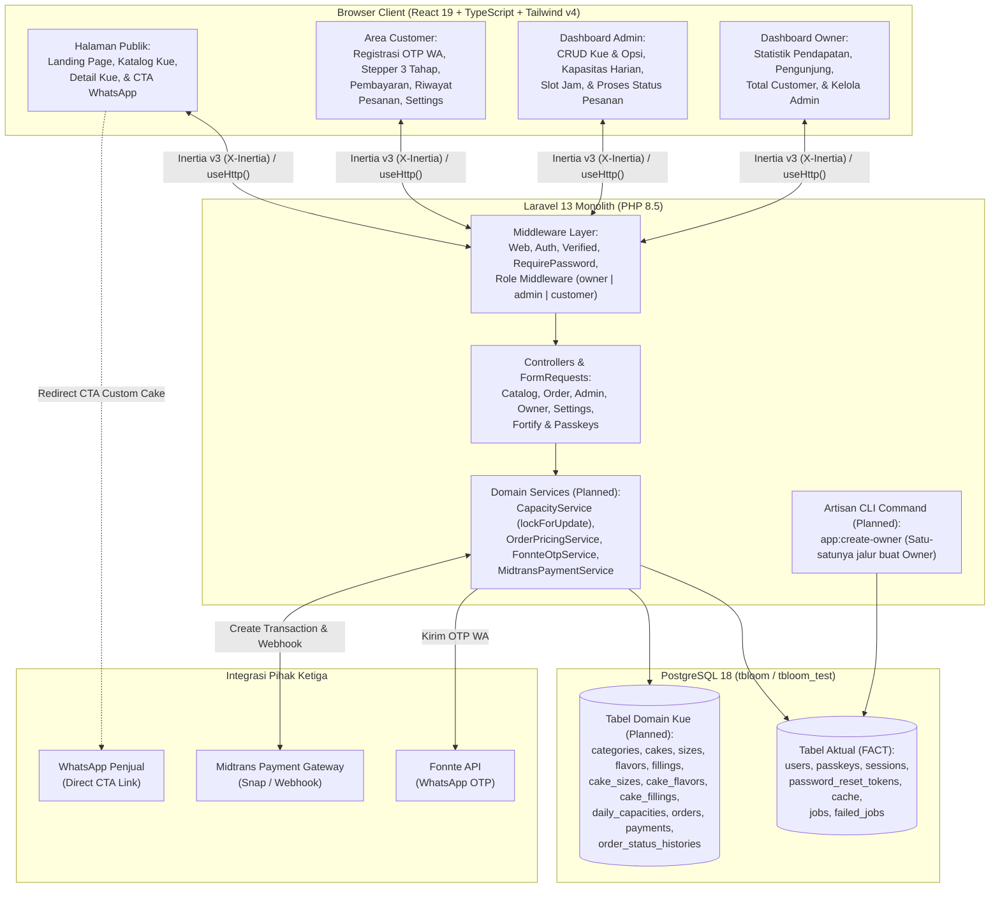

# Arsitektur Sistem (System Architecture) — TBloom Cake

Dokumen ini menjelaskan arsitektur teknis aktual yang sudah berjalan di repository **TBloom Cake (`tbloom`)** (`[FACT - Implemented]`) serta dampak dan perluasan arsitektur yang direncanakan untuk mendukung seluruh kebutuhan bisnis pemesanan kue custom berbasis katalog (`[CONFIRMED / PROPOSED - Planned]`).

---

## 1. Gambaran Umum & Gaya Arsitektur

- **Gaya Arsitektur (`[FACT]`):** **Modern Monolith (Server-Driven Single Page Application)** berbasis **Laravel 13** (PHP 8.5) dan **React 19** yang berkomunikasi melalui protokol **Inertia.js v3** dengan dukungan **Server-Side Rendering (SSR)** serta penyimpanan utama **PostgreSQL 18**.
- **Prinsip Pembagian Tanggung Jawab (`[CONFIRMED]`):**
    - **Backend Laravel adalah satu-satunya otoritas (_Single Source of Authority_)** untuk: Role-Based Access Control (RBAC), perhitungan zona waktu `Asia/Jakarta`, validasi `minimum_order_days`, pengecekan & penguncian kapasitas produksi harian (`DB::transaction` + `lockForUpdate()`), perhitungan total harga kue beserta biaya tambahan opsi dan fee Midtrans, pengiriman OTP WhatsApp via Fonnte API, serta verifikasi webhook Midtrans.
    - **Frontend React 19 hanya bertugas sebagai lapisan presentasi interaktif** yang menampilkan katalog, memandu pelanggan melalui form Stepper 3 Tahap, menampilkan sisa kapasitas dan rincian harga yang dikirim oleh backend, serta menampilkan hasil validasi dari server.

---

## 2. Arsitektur yang Sudah Terimplementasi di Repository (`[FACT - Implemented]`)

1. **HTTP Kernel & Middleware (`bootstrap/app.php`):**
    - Route `web` (`routes/web.php` + `routes/settings.php`), `commands` (`routes/console.php`), dan health check `/up`.
    - Cookie `appearance` dan `sidebar_state` dikecualikan dari enkripsi agar dapat disinkronkan antara JS client dan SSR server.
    - Middleware grup `web` menambahkan `HandleAppearance`, `HandleInertiaRequests`, dan `AddLinkHeadersForPreloadedAssets`.
2. **Service Providers (`bootstrap/providers.php`):**
    - `AppServiceProvider`: Mengatur `Date::use(CarbonImmutable::class)`, `DB::prohibitDestructiveCommands(app()->isProduction())`, dan aturan kekuatan `Password::defaults()`.
    - `FortifyServiceProvider`: Mengatur action `CreateNewUser` & `ResetUserPassword`, 7 halaman Inertia `auth/*`, serta rate limiter `login` (5/m), `two-factor` (5/m), dan `passkeys` (10/m).
3. **Database, Session, Cache, & Queue (`config/database.php`, `config/session.php`, `config/cache.php`, `config/queue.php`):**
    - Seluruhnya terhubung ke **PostgreSQL 18** (`pgsql`).

---

## 3. Dampak Arsitektur dari Konteks Bisnis TBloom Cake (`[CONFIRMED / PROPOSED - Planned]`)

Berikut adalah komponen arsitektur yang perlu ditambahkan atau disesuaikan ketika tahap implementasi fitur dimulai:

### 3.1 Konfigurasi Zona Waktu (`[CONFLICT / GAP]`)

- **Kondisi Aktual (`FACT`):** `config/app.php` baris 68 masih mengatur `'timezone' => 'UTC'`.
- **Kebutuhan Bisnis (`CONFIRMED`):** Perhitungan hari kalender `minimum_order_days` dan kapasitas produksi harian wajib menggunakan zona waktu **`Asia/Jakarta`**.
- **Dampak Arsitektur:** Saat implementasi dimulai, `config/app.php` perlu disesuaikan ke `'timezone' => env('APP_TIMEZONE', 'Asia/Jakarta')` atau setiap perhitungan tanggal bisnis secara eksplisit menggunakan `CarbonImmutable::now('Asia/Jakarta')`.

### 3.2 Arsitektur Autentikasi & Otorisasi 3 Role (RBAC)

- **Enum & Kolom Role:** Menambahkan enum `App\Enums\UserRole` (`Owner = 'owner'`, `Admin = 'admin'`, `Customer = 'customer'`) serta kolom `role`, `phone`, `phone_verified_at`, dan `is_active` pada tabel `users`.
- **Middleware Role (`EnsureUserHasRole`):** Membatasi akses grup route `/owner/*` hanya untuk `owner`, `/admin/*` hanya untuk `admin` (dengan `is_active = true`), dan `/orders/*` untuk `customer` yang telah terverifikasi.
- **Artisan Command (`CreateOwnerCommand`):** Menyediakan perintah CLI interaktif (mis. `php artisan app:create-owner`) sebagai **satu-satunya pintu pembuatan akun `owner`**.

### 3.3 Lapisan Service Domain (`app/Services/`)

Untuk menjaga Controller tetap ramping dan mudah diuji, logika bisnis kritis ditempatkan pada kelas Service:

1. **`CapacityService`:**
    - Menghitung `Sisa Kapasitas = Kapasitas Maksimum - Total Cake Terpakai` per tanggal kalender (`Asia/Jakarta`).
    - Menyediakan metode `reserveCapacity(CarbonImmutable $date, int $units = 1)` yang wajib dijalankan di dalam `DB::transaction()` menggunakan `DailyCapacity::where('production_date', $date)->lockForUpdate()->first()`.
2. **`OrderPricingService`:**
    - Menghitung harga secara otoritatif dari database: `base_price` (`cakes`) + `additional_price` ukuran (`cake_sizes`) + `additional_price` flavor (`cake_flavors`) + `additional_price` filling (`cake_fillings`) + kalkulasi biaya layanan Midtrans yang ditanggung Customer.
3. **`FonnteOtpService`:**
    - Mengelola pembuatan kode OTP 6 digit, hashing kode di database, pembatasan pengiriman ulang (throttling), dan pengiriman pesan WhatsApp ke endpoint HTTP Fonnte menggunakan `Http::withHeaders(['Authorization' => config('services.fonnte.token')])`.
4. **`MidtransPaymentService`:**
    - Membuat transaksi pembayaran Midtrans beserta rincian item (termasuk item biaya layanan/fee Midtrans yang dibebankan ke Customer) dan memverifikasi tanda tangan (`signature_key`) notifikasi webhook Midtrans.

### 3.4 Penyimpanan File Upload (`config/filesystems.php`)

- memerlukan penyimpanan pada disk `public` (`storage/app/public` yang di-link ke `public/storage` via `php artisan storage:link`) atau S3 untuk:
    1. Foto katalog produk kue yang diunggah Admin (`cakes.image`).
    2. Foto personalisasi kue yang diunggah Customer pada produk yang mengaktifkan `allow_image_upload = true` (`orders.uploaded_image`).
    3. Bukti pembayaran manual jika diperlukan (`payments.proof_image`).
