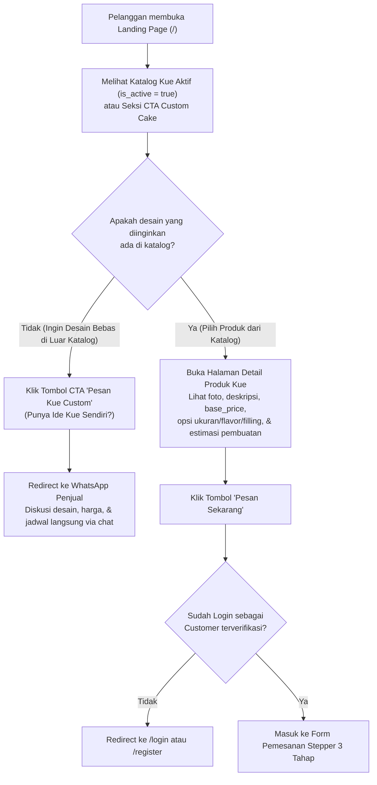
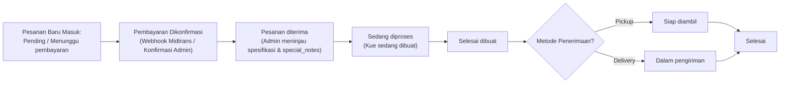

# Alur Pengguna (User Flow) — TBloom Cake

Dokumen ini mendokumentasikan alur pengguna untuk seluruh aktor di sistem **TBloom Cake (`tbloom`)**, dengan membedakan secara jelas antara:
- **Alur yang Sudah Diimplementasikan di Kode (`[FACT - Implemented]`)**
- **Alur Bisnis Resmi yang Direncanakan (`[CONFIRMED - Planned]`)**

---

## 1. Daftar Aktor Sistem (`[CONFIRMED]`)

1. **Guest (Pengunjung Publik):** Pengguna yang belum login; dapat menjelajahi landing page, melihat katalog & detail kue, menekan tombol CTA WhatsApp untuk kue custom di luar katalog, serta melakukan registrasi/login.
2. **Customer (`role = customer`):** Pelanggan terdaftar dengan nomor WhatsApp terverifikasi via OTP Fonnte API; dapat melakukan pemesanan kue katalog melalui Stepper 3 Tahap dan memantau status pesanannya.
3. **Admin (`role = admin`):** Pengelola operasional toko kue yang dibuat oleh Owner; mengelola katalog kue, opsi ukuran/flavor/filling, kapasitas produksi harian, slot jam, dan memproses status pesanan pelanggan.
4. **Owner (`role = owner`):** Pemilik usaha yang akunnya dibuat melalui Artisan CLI di server; mengelola akun Admin dan memantau statistik bisnis (pendapatan, pengunjung website, total akun Customer).

---

## 2. Alur Pembuatan Akun Berdasarkan Role (`[CONFIRMED - Planned]`)

```mermaid
flowchart TD
    subgraph CLI["1. Pembuatan Akun Owner (Server CLI Only)"]
        Cmd["Jalankan Artisan Command di Server CLI:\nphp artisan app:create-owner"] --> InputOwn["Input Nama, Email/WA, Password"]
        InputOwn --> SaveOwn["Simpan ke tabel users dengan role = 'owner'"]
    end

    subgraph OwnerWeb["2. Pembuatan Akun Admin (Dashboard Owner)"]
        OwnLogin["Owner Login ke Dashboard Owner"] --> OpenAdm["Buka Menu Manajemen Admin"]
        OpenAdm --> SubmitAdm["Isi Form Buat Admin Baru & Submit"]
        SubmitAdm --> SaveAdm["Simpan ke tabel users dengan role = 'admin', is_active = true"]
    end

    subgraph PubReg["3. Registrasi Mandiri Customer (Halaman Publik + Fonnte OTP)"]
        GuestReg["Guest membuka GET /register"] --> FillReg["Isi Nama, Nomor WhatsApp, Email, Password"]
        FillReg --> CreateCust["Simpan User dengan role = 'customer'\n& Generate OTP ke tabel whatsapp_otps"]
        CreateCust --> SendFonnte["Kirim Kode OTP ke Nomor WhatsApp via Fonnte API"]
        SendFonnte --> InputOTP["Customer memasukkan Kode OTP"]
        InputOTP --> ValidOTP{"OTP Valid &\nBelum Expired?"}
        ValidOTP -- Tidak --> ErrOTP["Tampilkan pesan error OTP / Kirim Ulang OTP"]
        ValidOTP -- Ya --> MarkVerified["Set phone_verified_at = now()\nCustomer dapat memesan kue"]
    end
```

> **Catatan Status Aktual (`[FACT - Implemented]`):** Saat ini di kode repository (`app/Actions/Fortify/CreateNewUser.php` dan `resources/js/pages/auth/register.tsx`), registrasi baru menerima `name`, `email`, `password` dan menggunakan verifikasi email (`GET /email/verify`). Integrasi nomor WhatsApp dan OTP Fonnte API berstatus **`Planned`**.

---

## 3. Alur Penjelajahan Katalog & 2 Jalur Pemesanan (`[CONFIRMED - Planned]`)

---

## 4. Alur Form Pemesanan Pelanggan — Stepper 3 Tahap (`[CONFIRMED - Planned]`)

Stepper wajib menyimpan state antar-tahapan saat tombol **Kembali** ditekan dan memvalidasi setiap tahapan sebelum tombol **Selanjutnya** mengizinkan perpindahan tahap.

```mermaid
flowchart TD
    subgraph Step1["Tahap 1: Detail Pesanan & Personalisasi Kue"]
        S1A["Informasi Pemesan diambil otomatis dari akun Customer login:\nNama Pemesan & Nomor WhatsApp (Read-only)"] --> S1B["Pilih Tanggal Dibutuhkan (required_date)"]
        S1B --> ValDate1{"Validasi Tanggal (Asia/Jakarta):\n1. required_date - today >= minimum_order_days?\n2. Sisa Kapasitas Harian >= 1?"}
        ValDate1 -- Tidak --> ErrDate1["Tampilkan pesan bahwa tanggal terlalu dekat\natau kuota produksi harian sudah penuh"]
        ValDate1 -- Ya --> S1C["Pilih Opsi Produk:\n1. Ukuran Kue (size_id)\n2. Flavor (flavor_id)\n3. Filling (filling_id)"]
        S1C --> S1D["Isi Personalisasi Kue:\n- Tulisan pada kue (cake_message)\n- Nama penerima (recipient_name)\n- Umur penerima (recipient_age)\n- Upload foto (HANYA jika allow_image_upload == true)\n- Catatan khusus opsional (special_notes)"]
        S1D --> Next1["Klik 'Selanjutnya' -> Validasi Tahap 1"]
    end

    subgraph Step2["Tahap 2: Pengiriman atau Pengambilan"]
        Next1 --> S2A{"Pilih Metode Penerimaan\n(fulfillment_method)"}
        S2A -- "Pickup (Ambil di Toko)" --> S2Pick["Tanpa Input Alamat Pengiriman"]
        S2A -- "Delivery (Kirim ke Alamat)" --> S2Deliv["Wajib Isi Alamat Pengiriman (delivery_address)"]
        S2Pick --> S2Schedule["Pilih Tanggal Penerimaan (delivery_date)\n& Pilih Slot Jam Tersedia (delivery_time)"]
        S2Deliv --> S2Schedule
        S2Schedule --> Next2["Klik 'Selanjutnya' -> Validasi Tahap 2\n(Atau Klik 'Kembali' ke Tahap 1 tanpa hilang data)"]
    end

    subgraph Step3["Tahap 3: Pembayaran & Konfirmasi"]
        Next2 --> S3Pay{"Pilih Metode Pembayaran\n(payment_method)"}
        S3Pay -- "Jika metode = Delivery" --> OnlyMid["Opsi 'Cash' DINONAKTIFKAN (Tidak bisa COD)\nHanya bisa memilih Payment Gateway (Midtrans)"]
        S3Pay -- "Jika metode = Pickup" --> BothPay["Dapat memilih:\n1. Cash (Bayar langsung di toko)\n2. Payment Gateway (Midtrans)"]
        OnlyMid --> Summary["Tampilkan Ringkasan Pesanan Lengkap & Rincian Harga Backend:\n- Harga Dasar + Harga Ukuran + Harga Flavor/Filling\n- Biaya Layanan Midtrans (jika memilih Midtrans, ditanggung Customer)\n- Total Pembayaran"]
        BothPay --> Summary
        Summary --> Confirm["Klik Tombol 'Konfirmasi Pesanan'\n(POST /orders)"]
    end

    Confirm --> BackendLock["Backend menjalankan DB::transaction + lockForUpdate()\npada kapasitas harian & menghitung ulang total harga"]
    BackendLock --> SaveOrder["Simpan ke orders, payments, order_status_histories\nTeruskan pesanan ke Dashboard Admin"]
```

---

## 5. Alur Pemrosesan Pesanan oleh Admin (`[CONFIRMED - Planned]`)

---

## 6. Alur Autentikasi & Pengaturan Akun yang Sudah Berjalan (`[FACT - Implemented]`)

1. **Alur Login Email/Password, 2FA, & Passkey:**
   - Pengguna membuka `GET /login` (`resources/js/pages/auth/login.tsx`), dapat memilih tombol **Sign in with a passkey** (`usePasskeyVerify`) atau mengisi email & password (`POST /login`).
   - Jika pengguna memiliki 2FA aktif, pengguna diarahkan ke `GET /two-factor-challenge` (`resources/js/pages/auth/two-factor-challenge.tsx`) untuk memasukkan kode OTP 6 digit atau *recovery code*.
2. **Alur Pengaturan Akun (`/settings/*`):**
   - **Profile (`/settings/profile`):** Mengubah nama & email (`PATCH /settings/profile`) atau menghapus akun permanen (`DELETE /settings/profile` dengan konfirmasi password).
   - **Security (`/settings/security`):** Dilindungi middleware `RequirePassword` (konfirmasi password atau passkey di `/user/confirm-password`). Pengguna dapat mengganti password, mengaktifkan/menonaktifkan 2FA TOTP, dan menambah/menghapus Passkeys WebAuthn.
   - **Appearance (`/settings/appearance`):** Memilih tema *Light*, *Dark*, atau *System* yang disimpan di `localStorage` dan cookie `appearance`.
